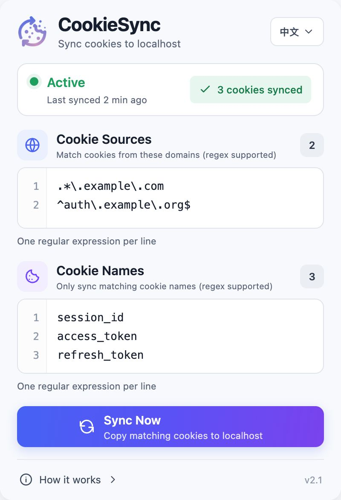
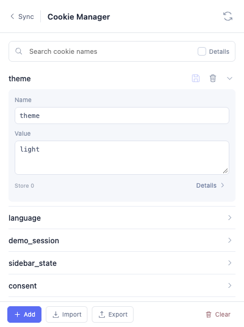

<p align="center">
  
</p>

<h1 align="center">CookieSync</h1>

<p align="center">
  Automatically copy cookies from remote domains to <code>http://localhost</code> for local development.
</p>

<p align="center">
  English · <a href="README.zh-CN.md">简体中文</a>
</p>

> [!NOTE]
> Forked from [roelnoten/cookiesync](https://github.com/roelnoten/cookiesync). Big thanks to [Roel Noten](https://github.com/roelnoten) for creating and open-sourcing the original project.

## Why CookieSync?

When developing locally on `localhost`, your app often can't read login or session cookies set on staging or production domains.

**CookieSync** solves this without manual copy-pasting: configure domain and cookie-name regex rules, and the extension will automatically copy matching cookies to `http://localhost` whenever they change (or on demand with one click). It also includes a handy built-in Cookie Manager for inspecting and editing cookies on the active tab.

| Cookie Sync | Cookie Manager |
| :---: | :---: |
|  |  |

## Features

- **Auto & Manual Sync**: Syncs in the background when remote cookies update, or immediately via **Sync Now**.
- **Multi-Regex Rules**: Match multiple source domains and cookie names (one regex per line).
- **Localhost-Ready**: Automatically strips `Secure` and converts `SameSite=None` to `Lax` so cookies work over `http://localhost`.
- **Built-in Cookie Manager**: Click the top cookie icon to search, add, edit, delete, or import/export JSON cookies for the current page.
- **Private & Bilingual**: English and Simplified Chinese UI. Everything runs locally in your browser—nothing is uploaded anywhere.

## Installation

1. Clone this repository (or download and unzip from [Releases](https://github.com/wilsonyiyi/cookiesync/releases)):
   ```bash
   git clone https://github.com/wilsonyiyi/cookiesync.git
   ```
2. Open `chrome://extensions` in Chrome and enable **Developer mode**.
3. Click **Load unpacked** and select the `chrome` folder.

## Usage

Open the popup and enter your regex rules (one per line, saved automatically):

1. **Cookie Sources (Domain Regex)**
   ```regex
   .*\.example\.com
   ^auth\.example\.org$
   ```
2. **Cookie Names (Name Regex)**
   ```regex
   ^session_id$
   ^access_token$
   ```

Click **Sync Now** to copy existing cookies right away. Future changes on matching domains will sync automatically in the background.

> **Tips**:
> - Make sure your local app runs on `http://localhost`, not `127.0.0.1` (browsers treat their cookies separately).
> - If a cookie isn't syncing, double-check your regex syntax and verify the cookie exists on the source site.

### Import configuration

Open Settings → Import configuration to launch a small standalone window. Choose a CookieSync configuration JSON file, wait for the success message and rule counts, then select Done. Reopen the toolbar popup to use the imported settings. The import window stays open when focus moves away, so file selection does not depend on the toolbar popup remaining alive.

## Development

All extension files live in [`chrome/`](chrome) with zero build steps. After making changes, click **Reload** on the extension card in `chrome://extensions`.

To create a release zip archive:

```bash
npm run package
```

## Credits & License

- Original project: [roelnoten/cookiesync](https://github.com/roelnoten/cookiesync) by [Roel Noten](https://github.com/roelnoten)
- Manifest V3 migration: [Erik Bessegato](https://github.com/erik-bessegato)
- License: [LICENSE](LICENSE)
