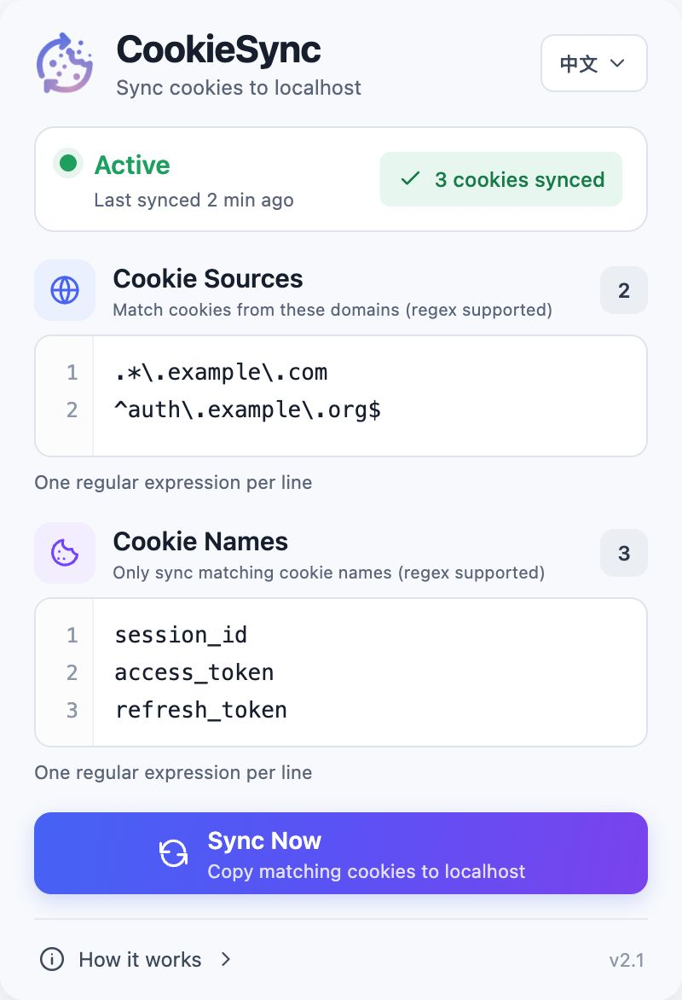
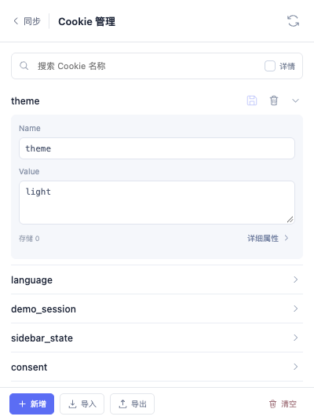

<p align="center">
  
</p>

<h1 align="center">CookieSync</h1>

<p align="center">
  把远程网站的 Cookie 自动同步到 <code>http://localhost</code>，省去本地开发来回复制 Cookie 的麻烦。
</p>

<p align="center">
  <a href="README.md">English</a> · 简体中文
</p>

> [!NOTE]
> 本项目 Fork 自 [roelnoten/cookiesync](https://github.com/roelnoten/cookiesync)，感谢原作者 [Roel Noten](https://github.com/roelnoten) 的开源贡献。

## 解决什么问题？

本地前端跑在 `localhost` 时，往往读不到测试环境或线上域名下的登录态 Cookie。

**CookieSync** 的做法很简单：你配置好“来源域名”和“Cookie 名称”两条正则规则，只要远程网站的 Cookie 有更新，它就会自动往 `http://localhost` 复制一份（也可以点一下按钮手动同步）。此外，它还顺带内置了一个轻量的当前页面 Cookie 管理器，方便日常调试。

| 同步规则配置 | 当前页 Cookie 管理 |
| :---: | :---: |
|  |  |

## 核心功能

- **自动 + 手动同步**：远程 Cookie 变化时后台自动同步，也可以随时点击「立即同步」全量扫描。
- **多规则匹配**：来源域名和 Cookie 名称均支持多行正则（每行一条，满足其一即匹配）。
- **自动适配 localhost**：复制时自动关闭 `Secure`，并将 `SameSite=None` 转为 `Lax`，确保 `http://localhost` 能正常携带。
- **当前页 Cookie 管理**：点击顶部 Cookie 图标即可搜索、新增、修改、删除当前页面的 Cookie，支持 JSON 导入导出。
- **开箱即用**：支持中英文切换，所有数据仅保存在浏览器本地，不上传任何服务器。

## 安装

1. 下载本仓库代码（或从 [Releases](https://github.com/wilsonyiyi/cookiesync/releases) 下载解压）：
   ```bash
   git clone https://github.com/wilsonyiyi/cookiesync.git
   ```
2. 浏览器打开 `chrome://extensions`，开启右上角的**开发者模式**。
3. 点击左上角**加载已解压的扩展程序**，选择仓库里的 `chrome` 文件夹即可。

## 怎么用

打开插件面板，填写两部分正则规则（每行一条，自动保存）：

1. **Cookie 来源（域名正则）**
   ```regex
   .*\.example\.com
   ^auth\.example\.org$
   ```
2. **Cookie 名称（名称正则）**
   ```regex
   ^session_id$
   ^access_token$
   ```

填好后点一次**立即同步**，就能看到同步成功的 Cookie 数量。之后你在远程网站重新登录或刷新状态时，插件会自动同步。

> **排查小贴士**：
> - 本地访问请使用 `http://localhost:端口`，不要用 `127.0.0.1`（两者的 Cookie 不互通）。
> - 如果没同步成功，先检查正则表达式是否写对，以及对应网站下是否确实存在该 Cookie。

### 配置导入

在设置中点击“导入配置”，会打开独立的小窗口。点击“选择 JSON 文件”，选择 CookieSync 导出的配置文件；窗口显示导入成功及规则数量后，点击“完成”。重新打开主 Popup 即可使用新配置。此窗口切换焦点后会保留，避免文件选择过程中工具栏 Popup 关闭导致导入中断。

## 本地开发

代码都在 [`chrome/`](chrome) 目录下，没有任何构建打包步骤，改完代码去 `chrome://extensions` 点一下刷新就能生效。

如果需要打 zip 包：

```bash
npm run package
```

## 致谢与协议

- 原项目与作者：[roelnoten/cookiesync](https://github.com/roelnoten/cookiesync) by [Roel Noten](https://github.com/roelnoten)
- Manifest V3 升级：[Erik Bessegato](https://github.com/erik-bessegato)
- 开源协议：[LICENSE](LICENSE)
